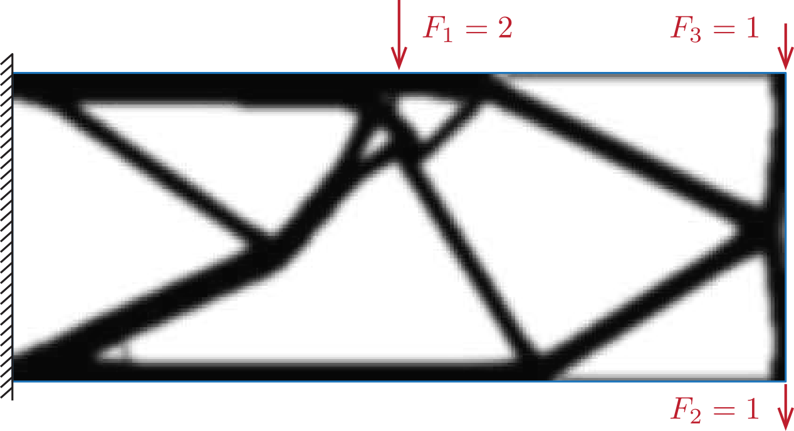

# MultiLoadTop

MultiLoadTop is a MATLAB development, that aims to address the optimization problem of structures with multiple load cases. To solve this problem, a variety of methods are incorporated into this development. The main script has the following structure: 
1) Domain generation
2) Parameters definition
3) Optimization
4) Analysis
5) Results representation.

Among the methods employed for solving this problem are:
1) Pareto front
2) Pareto search
3) Arbitrary weight selection
4) P-Norm aproximation
5) KS aproximation
6) Dual method
7) Upper bounded method

More information can be found in the related article. 

Salinas D, Zegard T (2026) Structural topology optimization with multiple load cases: methods and
review

<table>
<tr>
<td></td>
</tr>
</table>
