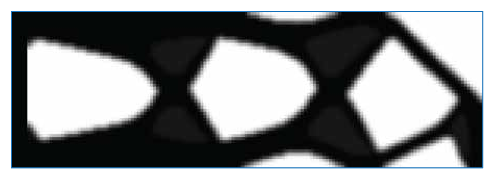

# ShapeTop

ShapeTop is a MATLAB development, offering the implementation of a novel approach for shape optimization through constrained topology optimization.  The main script has the following structure: 
1) Domain generation
2) Parameters definition
3) Optimization
4) Analysis
5) Results representation.

More information can be found in the related articles. 

[Zegard T, Salinas D, Silva E (2025) Pixel-based shape optimization in 2D using constrained density-based topology optimization. Engineering with Computers](https://link.springer.com/article/10.1007/s00366-025-02129-9)

[Gutiérrez A, Salinas D, Zegard T (2025) Pixel-based shape optimization in 3D using constrained density-based topology optimization. Engineering with Computers](https://link.springer.com/article/10.1007/s00366-025-02220-1)

<table>
<tr>
<td></td>
</tr>
</table>

